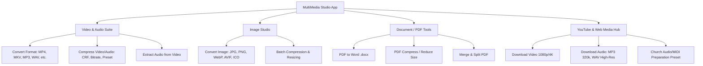
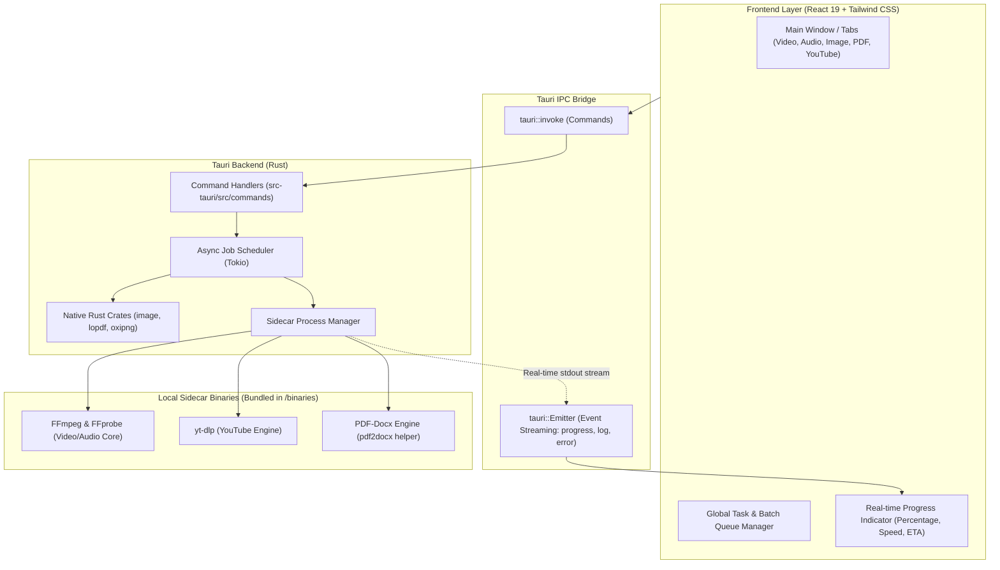

# Product Requirement Document (PRD)
## MultiMedia Studio Desktop (All-in-One Multimedia Suite)

**Document Version:** 1.0  
**Status:** Ready for Review  
**Target Platform:** Windows Desktop (Cross-platform ready: macOS, Linux)  
**Base Architecture:** Tauri v2 + React 19 + TypeScript + Rust Backend  

---

## 1. Executive Summary & Objective

### 1.1 Background
Banyak pengguna, khususnya tim multimedia/musik gereja, konten kreator, dan staf administrasi, harus berpindah-pindah antar berbagai website pihak ketiga (seperti iLovePDF, CloudConvert, Y2Mate) hanya untuk melakukan tugas-tugas rutin:
1. Konversi format video/audio untuk sound system atau playback software.
2. Mengambil audio backing track atau referensi lagu dari YouTube untuk aransemen dan input MIDI/keyboard.
3. Kompresi gambar, video, dan PDF agar muat dikirim via email/WhatsApp.
4. Konversi PDF dokumen/warta gereja ke Word (DOCX) untuk diedit ulang.

Layanan berbasis web memiliki banyak kendala:
- **Iklan berbahaya dan risiko malware/phishing.**
- **Batasan kuota gratis** (limit ukuran file dan limit frekuensi per hari).
- **Masalah privasi:** Dokumen sensitif diunggah ke server pihak ketiga.
- **Ketergantungan internet:** Tidak bisa dipakai saat rehearsal offline atau di area dengan jaringan lambat.

### 1.2 Objective
Membangun **MultiMedia Studio**, aplikasi desktop lokal (*offline-first* dan *privacy-friendly*) yang ringan, berkinerja tinggi, dan serbaguna untuk menangani seluruh kebutuhan multimedia dalam satu antarmuka modern yang intuitif.

---

## 2. Target Persona & Key Use Cases

| Persona | Kebutuhan Utama | Fitur Unggulan Terkait |
| :--- | :--- | :--- |
| **Tim Multimedia & Musik Gereja** | Mengunduh backing track dari YouTube, mengambil audio jernih (WAV/MP3 320kbps) untuk di-load ke keyboard/DAW/MIDI sequencer, kompres video rekaman khotbah/ibadah. | YouTube Grabber (Audio Presets), Video/Audio Compressor, Pitch/Tempo Transpose helper. |
| **Sekretariat / Admin Gereja & Kantor** | Mengubah warta/surat PDF menjadi Word, memperkecil ukuran PDF arsip, kompres foto kegiatan jemaat. | PDF to DOCX Converter, PDF Compressor, Batch Image Compressor. |
| **Konten Kreator / Tim Live Streaming** | Konversi format video (OBS capture MKV ke MP4/ProRes), batch resize gambar thumbnail, konversi audio podcast/vocal. | FFmpeg Fast Transcode, Lossless WebP/PNG converter, Audio normalizer. |

---

## 3. Scope & Functional Requirements

### 3.1 Module 1: Video & Audio Suite (Engine: FFmpeg)
*   **Video Formats Supported:** MP4, MKV, MOV, AVI, WebM, TS, FLV.
*   **Audio Formats Supported:** MP3, WAV, FLAC, AAC, OGG, M4A, OPUS.
*   **Key Features:**
    *   **Convert:** Transcoding video antar-container dan codec (H.264, H.265/HEVC, AV1, VP9) dengan opsi akselerasi hardware (NVENC, QuickSync, AMF jika tersedia).
    *   **Extract Audio:** Ekstraksi audio track dari video menjadi MP3/WAV dalam 1-klik.
    *   **Compress Video:** 
        *   Preset Target Size (contoh: "Kompres agar pas untuk WhatsApp < 16MB / < 64MB" atau "Target 50MB").
        *   Preset Kualitas: CRF (Constant Rate Factor: 18-28) dan resolusi scaling (1080p -> 720p).
    *   **Compress Audio:** Pengaturan bitrate (320kbps -> 128kbps/64kbps) dan normalisasi volume (EBU R128).

### 3.2 Module 2: Image Studio (Engine: Rust Image Crates / Sharp)
*   **Formats Supported:** PNG, JPG/JPEG, WebP, AVIF, BMP, TIFF, ICO, SVG.
*   **Key Features:**
    *   **Batch Convert:** Mengubah puluhan file sekaligus ke format modern (WebP/AVIF untuk web, JPG untuk kompatibilitas).
    *   **Smart Compress:**
        *   Lossy compression (mengurangi kualitas visual 1-100% tanpa artefak mencolok).
        *   Lossless optimization (menghapus metadata EXIF yang tidak diperlukan).
    *   **Resize & Scale:** Batch resize berdasarkan persentase atau dimensi (Width x Height), serta rasio aspek terkunci.
    *   **Favicon/Icon Generator:** Konversi PNG ke format `.ico` multi-resolusi (16x16, 32x32, 64x64, 128x128).

### 3.3 Module 3: PDF & Document Hub
*   **Key Features:**
    *   **PDF to Word (.docx):**
        *   Mengonversi dokumen PDF kembali ke format Microsoft Word editable.
        *   Menjaga struktur layout, tabel, paragraf, dan gambar (menggunakan engine `pdf2docx` via background sidecar process).
    *   **PDF Compressor:**
        *   Tiga level kompresi:
            *   *Low (Screen Quality / 72 DPI):* Ukuran sekecil mungkin untuk email/chat.
            *   *Medium (E-Book / 150 DPI):* Keseimbangan pas untuk dibaca di layar & dicetak standar.
            *   *High (Print Quality / 300 DPI):* Hanya kompresi lossless metadata dan stream.
    *   **PDF Merge & Split (Fast-win):** Menggabungkan beberapa PDF menjadi satu atau mengekstrak halaman tertentu.

### 3.4 Module 4: YouTube & URL Media Hub (Engine: yt-dlp)
*   **Key Features:**
    *   **Pasting & Validation:** Deteksi otomatis link YouTube dari clipboard saat aplikasi dibuka.
    *   **Metadata Fetching:** Menampilkan judul video, thumbnail, durasi, dan channel sebelum mulai mendownload.
    *   **Audio Download Modes:**
        *   *Preset: Church Accompaniment / DAW (WAV 48kHz 24-bit)* – Audio uncompressed tanpa kehilangan frekuensi untuk playback di sound system gereja.
        *   *Preset: High Quality MP3 (320 kbps CBR)* – Untuk dibagikan ke grup pemain musik/singer.
        *   *Preset: Mobile / Voice Note (128 kbps M4A/AAC)* – Ringan untuk dikirim via WA.
    *   **Video Download Modes:** Pilihan resolusi (1080p Full HD, 720p HD, 480p, atau Best Available).
    *   **Auto-Update Mechanism:** Tombol 1-klik untuk memperbarui engine `yt-dlp` jika YouTube mengubah protokol streaming mereka.
    *   *(Future Enhancement / Phase 2)*: Audio-to-MIDI transcription helper (menggunakan model AI seperti Spotify Basic-Pitch untuk mengubah solo piano/instrumen YouTube menjadi MIDI).

---

## 4. Technical Architecture

Aplikasi dibangun di atas pondasi yang sudah ada di repositori: **Tauri v2 + React 19 + TypeScript + Tailwind CSS**.

### 4.1 Component Breakdown

1.  **Frontend (React 19, TypeScript, Tailwind CSS, Lucide Icons):**
    *   Navigasi Tab: `Dashboard`, `Video/Audio`, `Image`, `PDF`, `YouTube Downloader`, `Settings`.
    *   Drag-and-Drop Area: Pengguna dapat menyeret file apapun ke aplikasi. Aplikasi otomatis mendeteksi tipe mime dan mengarahkan ke tab yang relevan.
    *   Task Queue: Menampilkan status antrean (Pending, Processing, Done, Failed) dengan tombol Cancel dan Open Output Folder.

2.  **Tauri Rust Backend (`src-tauri`):**
    *   Mengatur eksekusi proses background dengan Tokio (asinkron, tidak memblokir UI thread).
    *   Streaming parsing output CLI (misal: regex matcher untuk membaca output progress percentage dari FFmpeg dan yt-dlp).
    *   Operasi file native: File dialog picker, validasi path Windows, dan membuka file explorer (`tauri-plugin-opener`).

3.  **Engine & Sidecars Strategy:**
    *   **FFmpeg:** Menggunakan executable static build FFmpeg (diletakkan di `src-tauri/bin/ffmpeg-x86_64-pc-windows-msvc.exe`).
    *   **yt-dlp:** Single standalone executable (`yt-dlp.exe`) yang diperbarui via argumen internal `-U`.
    *   **Image Processing:** Menggunakan crate Rust native (`image`, `webp`, `oxipng`) sehingga tidak memerlukan binary eksternal untuk kompresi dan konversi gambar, menghemat ukuran installer dan performa instan.
    *   **PDF to Word:** Menjalankan standalone micro-runner Python (di-compile dengan Nuitka atau PyInstaller) khusus menjalankan library `pdf2docx` tanpa membutuhkan instalasi Python di komputer user.

---

## 5. User Experience (UX) & Interface Specifications

### 5.1 Main Layout Wireframe Concept
*   **Sidebar Navigation (Kiri, 64px - 200px collapsible):**
    *   🎬 Video Converter & Compressor
    *   🎵 Audio Tools & Extractor
    *   🖼️ Image Converter & Optimizer
    *   📄 PDF & Documents
    *   🌐 YouTube Grabber
    *   ⚙️ Settings (Default download folder, Hardware Acceleration toggles, Engine status)
*   **Header Bar:**
    *   Status indikator engine (FFmpeg: Ready, yt-dlp: Ready).
    *   Folder output selector (Default: `~/Videos/MultiMedia` atau custom).
*   **Content Area:**
    *   *State Kosong:* Hero Drag-and-Drop Dropzone dengan tombol "Browse Files".
    *   *State Aktif:* Tabel antrean batch dengan kolom: Nama File, Ukuran Asli, Target Format, Progress Bar (%), Estimasi Sisa Waktu, Aksi (Start, Pause, Remove, Open Folder).

### 5.2 Error Handling & Feedback
*   Jika link YouTube bukan video publik / terkena copyright restriction: Tampilkan pesan error ramah pengguna dengan tombol saran (cek link / coba lagi).
*   Jika konversi video gagal: Tampilkan log FFmpeg singkat yang dapat disalin untuk debugging.
*   Jika proses PDF terproteksi password: Munculkan modal input password dokumen.

---

## 6. Implementation Roadmap & Milestones

### Phase 1: Foundation & Binary Setup (Minggu 1)
- [ ] Konfigurasi `tauri-plugin-shell` dan permissions di Tauri v2.
- [ ] Pengunduhan dan penataan binary sidecar (`ffmpeg.exe`, `ffprobe.exe`, `yt-dlp.exe`) ke direktori sidecars Tauri.
- [ ] Pembuatan wrapper Rust untuk mendeteksi ketersediaan binary dan versi engine.
- [ ] Setup UI layout modern (Sidebar, Header, Drag-Drop dropzone) menggunakan Tailwind CSS dan Lucide Icons.

### Phase 2: YouTube Downloader & Audio Workflow (Minggu 2)
- [ ] Implementasi form input URL dengan tombol "Paste" otomatis.
- [ ] Parsing metadata video (judul, thumbnail, durasi) via `yt-dlp -J`.
- [ ] Implementasi preset unduhan:
    - Audio MP3 320k (CBR)
    - Audio WAV High Quality
    - Video 1080p / 720p (MP4 container)
- [ ] Streaming progress bar (persentase download + kecepatan download) ke UI React.

### Phase 3: Video & Audio Converter & Compressor (Minggu 3)
- [ ] Drag-and-drop batch video/audio files.
- [ ] Preset kompresi video (Target size WhatsApp < 64MB, Web, High Quality).
- [ ] Preset konversi video (MKV/MOV -> MP4) dan audio (WAV/FLAC -> MP3).
- [ ] Real-time FFmpeg progress parser (membaca `time=...` dari stderr FFmpeg).

### Phase 4: Image Studio & PDF Suite (Minggu 4)
- [ ] Implementasi crate Rust native `image` untuk batch resize dan convert (PNG, JPG, WebP).
- [ ] Implementasi kompresi lossless dan lossy untuk gambar.
- [ ] Setup sidecar runner untuk `pdf2docx` (PDF ke Word).
- [ ] Implementasi PDF compressor dan merge/split.

### Phase 5: Polish, Test & Release Packaging (Minggu 5)
- [ ] Pengujian performa memory dan CPU saat batch processing.
- [ ] InnoSetup / NSIS installer packaging via `npm run tauri build`.
- [ ] Dokumentasi penggunaan dan tombol auto-update engine.
